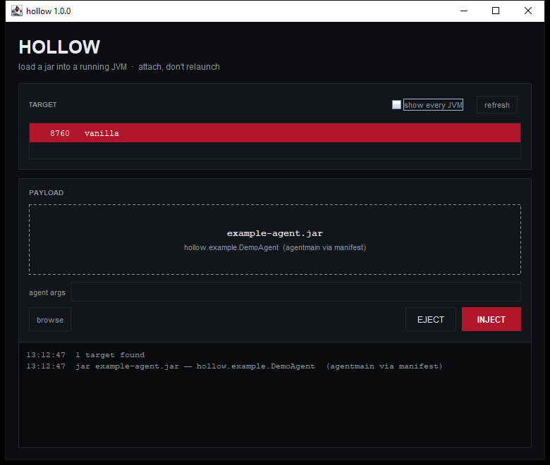

# hollow

<p>
  
  
  
  
</p>

**Load a jar into a running JVM. No relaunch, no launcher flags, no trace in the game log.**

hollow attaches to a live Minecraft process through the JVM attach API, drops a small
control agent in, and from then on loads whatever jar you hand it — a proper Java agent,
a jar with an `agentmain`, or a plain library you just want on the classpath. Eject
takes it back out.



```
  drop a .jar  →  pick the process  →  INJECT
```

---

## Why it is quiet

Three separate things have to stay silent, and hollow handles all three.

| Source of noise | What hollow does |
|---|---|
| The payload printing to `System.out` / `System.err` | The stream is swapped for a null sink while `agentmain` runs |
| The payload logging through log4j2 | A `DENY` filter is installed on the **root LoggerConfig**, so events from the payload's package never reach an appender — not `latest.log`, not the launcher console |
| hollow itself | It never prints anything, at all |

The log4j2 filter is the interesting part. Minecraft's config routes every event through
the root `LoggerConfig` before any appender sees it. Adding a filter there removes the
payload's output from the file and the console at the same time, without touching a single
config file on disk and without leaving a mark when the game exits.

If log4j2 is not on the classpath, the install is a no-op and the stream swap carries it.

---

## How it works

```
injector                          game JVM
────────                          ────────
VirtualMachine.attach(pid)
  └─ loadAgent(hollow-core.jar, "port=…;token=…")
                                  Bootstrap.agentmain()
                                    ├─ silence System.out / System.err
                                    ├─ install log4j2 DENY filter
                                    └─ Control.start()  ← 127.0.0.1:port
  connect + HELLO <token>  ──────►
                           ◄──────  OK <pid> <java.version> <user.dir>
  LOAD <jar> <class>       ──────►
                                    ├─ Instrumentation.appendToSystemClassLoaderSearch
                                    ├─ Class.forName(class)
                                    └─ invoke agentmain(args, inst)
                           ◄──────  OK p1
```

Everything after the first attach runs over a loopback socket guarded by a 128-bit token
the injector generated. The channel is recorded in `%TEMP%\hollow\<pid>.json`, so a second
run of the injector finds it again without re-attaching, and `--eject` works from a
completely fresh process.

`QUIT` deletes the handshake file and closes the socket.

### Entry point discovery

hollow does not need the jar to be a well-formed agent. It reads the class files directly —
constant pool, access flags, method table — and finds a `public static agentmain` or
`premain` anywhere in the archive. Zero parsing dependencies; the class-file reader is
about 150 lines in [`ClassFile.java`](src/injector/hollow/injector/ClassFile.java).

Order of preference:

1. `Agent-Class` in the manifest
2. `Premain-Class` in the manifest
3. A scanned class with `public static agentmain(...)` or `premain(...)`
4. Nothing — the jar is appended to the system classpath and left there

### Eject

A payload can define `public static void unload()`. hollow calls it reflectively.

Classes cannot be removed from a loaded class loader — that is a JVM invariant, not a
hollow limitation. A payload with no unload hook is detached from hollow's registry and
stays resident until the game exits. hollow says so instead of pretending otherwise.

---

## Quick start

Grab a release, or build it (below), then:

```
hollow.bat
```

1. Start Minecraft.
2. Press **refresh** — the running game appears with its version and profile folder.
3. Drag a `.jar` onto the drop zone.
4. Press **INJECT**.

The jar's entry point is detected automatically and shown above the button. Use the
**agent args** field if your payload reads them.

Press **EJECT** to unload.

### Command line

```
hollow --list                       list game JVMs
hollow --list --all                 list every java process
hollow --inject --pid 1234 --jar payload.jar [--class a.b.C] [--args "x"]
hollow --eject  --pid 1234
hollow --version
```

The CLI prints what it did. It never touches the game's console.

---

## Build

Needs a JDK 17 or newer. Nothing else.

```powershell
.\build.ps1                 # jars + a jlink runtime in dist/
.\build.ps1 -NoRuntime      # jars only
.\build.ps1 -Jdk C:\jdk-21  # pick a JDK
```

```bash
./build.sh                  # same, on Linux/macOS
```

Output:

| file | what it is |
|---|---|
| `hollow-core.jar` | the agent that goes into the game |
| `hollow.jar` | the injector, GUI and CLI |
| `example-agent.jar` | proof-of-life payload — a badge in the corner of the screen |
| `runtime/` | a jlink image, so the injector needs no installed JDK |
| `hollow.bat` | launcher that uses `runtime/` |

### Test

```powershell
.\test.ps1          # attach, load, eject, against a throwaway JVM
.\tools\test-log.ps1   # proves the quiet claim against real log4j2
```

`test.ps1` starts a throwaway JVM, attaches, loads a headless probe, checks the marker
file, ejects, checks the marker is gone, kills the JVM. Prints `PASS` or the failures.

`test-log.ps1` starts a JVM that logs twice a second through log4j2, injects a payload
that writes to `System.out`, `System.err` and log4j2, then asserts the harness lines are
in the log and the payload's lines are not. It fetches log4j-api and log4j-core from Maven
Central unless you pass `-Log4jDir`.

The target JVM needs the `java.instrument` module. Every full JDK and JRE ships it; a
hand-trimmed jlink image might not.

---

## Writing a payload

Two methods, both found reflectively. Neither has to be in the manifest.

```java
package my.payload;

import java.lang.instrument.Instrumentation;

public final class Payload {

    public static void agentmain(String args, Instrumentation instrumentation) {
        // runs inside the game's JVM
    }

    public static void unload() {
        // called on eject; remove your threads, hooks and windows here
    }
}
```

Drop the jar on hollow, press inject. That is the whole interface.

The `Instrumentation` parameter is optional — `agentmain(String)` works too.

Two things worth knowing:

- **Your threads keep the game alive.** Use daemon threads, or stop them in `unload()`.
- **Do not call `System.exit`.** You are inside the game.

---

## Limits, stated plainly

**One warning on stderr.** JDK 21 (JEP 451) prints four `WARNING:` lines to the process's
`System.err` the first time an agent is loaded dynamically. That is native code in
`InstrumentationImpl` and it is gated on the `EnableDynamicAgentLoading` VM flag, which
cannot be set on a JVM that is already running — the flag has to be on the command line at
launch.

Those lines are **not** log4j events, so they do not enter `logs/latest.log`. They appear in
the launcher's console or in a launcher-side log if the launcher mirrors stderr. hollow
strips them from `logs/latest.log` when it finds them there. To stop them at the source, add
to the launcher's JVM arguments:

```
-XX:+EnableDynamicAgentLoading
```

**Same user.** Attaching to a process owned by another user, or to an elevated process from
a non-elevated injector, fails. That is the OS, not hollow.

**Attach can be switched off.** A JVM started with `-XX:+DisableAttachMechanism` has no
attach listener and cannot be reached by any tool.

**Mod loaders are not required.** hollow works on vanilla, Fabric, Forge, NeoForge and
Quilt, because it does not go through the loader at all.

**Server-side jars are a different target.** This is a client-side JVM attach tool.

---

## Layout

```
src/core/hollow/core/
  Bootstrap.java     agentmain, stream silence, handshake
  Control.java       loopback control server
  Payloads.java      load / unload registry
  LogFilter.java     log4j2 root filter via dynamic proxy

src/injector/hollow/injector/
  Main.java          CLI
  Frame.java         window
  Attach.java        VirtualMachine.loadAgent
  Session.java       attach-or-reuse, control client
  Remote.java        protocol client
  ClassFile.java     .class reader
  JarScan.java       entry-point discovery
  GameJvm.java       process discovery
  LogScrub.java      latest.log cleanup

src/example/         demo payload
src/fixtures/        test harness and probe
```

---

## License

MIT. See [LICENSE](LICENSE).
